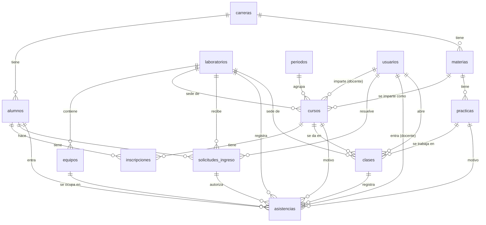

# Modelo de datos

Qué hace el sistema según la base de datos recibida, qué problemas tenía esa base y cómo queda el esquema propuesto.

**Estado: propuesta.** El esquema nuevo está en [db/esquema.sql](../db/esquema.sql) y se probó en MariaDB 11.8. Falta que el equipo lo revise y que el instituto responda las preguntas del final.

**Qué usa ya la API.** De las 15 tablas, 13 están en uso. Las dos que faltan, `solicitudes_ingreso` y `notificaciones`, existen en el esquema pero ninguna ruta las toca todavía: corresponden al uso del laboratorio fuera de clase, que espera respuestas del instituto. De `asistencias` solo se registran las de alumnos en clase; las de docentes e invitados aún no.

Última actualización: 11 de octubre de 2026.

## Qué hace el sistema

Controla quién usa los laboratorios de cómputo del ITSPP:

1. **Registro de entrada y salida.** El docente abre la clase de su curso en un laboratorio. Mientras está abierta, cada alumno inscrito registra su propia entrada con su número de control, desde cualquier computadora o teléfono, e indica la computadora que ocupa o que trae su propio equipo. Cuando el docente cierra la clase se registra la salida de todos. El alumno nunca registra su salida.
2. **Estado de los equipos.** Para cada equipo se sabe si está libre, en uso o fuera de servicio, y quién lo está usando.
3. **Solicitudes de ingreso.** Un alumno pide usar un laboratorio fuera de su clase, con un motivo; alguien la aprueba o la rechaza.
4. **Materias y prácticas.** Cada materia tiene un docente, un periodo, un laboratorio y una lista de prácticas.
5. **Avisos al administrador**, por laboratorio y con prioridad (por ejemplo, un equipo que falla).
6. **Bitácora** de acciones.

Hay cuatro tipos de persona: administrador, laboratorista y docente, que inician sesión; y alumno, que se identifica por matrícula y no tiene contraseña.

## Problemas de la base recibida

| Problema | Consecuencia |
|---|---|
| Cada asistencia copia nombre, carrera, semestre y grupo del alumno | Si se corrige un dato del alumno, el historial queda con el dato viejo; y ocupa espacio de más |
| `asistencias` no está ligada a `alumnos`, `equipos` ni laboratorios | Se puede registrar la entrada de una matrícula o un equipo que no existen |
| Dos tablas para lo mismo (`asistencias` y `asistencias_historico`) | Hay que mover filas de una a otra al salir; si falla a medias, se pierde o se duplica el registro |
| `equipos.en_uso` y `usuario_actual` se guardan aparte de las asistencias | Pueden contradecirse: un equipo marcado en uso sin nadie dentro, o al revés |
| Laboratorio, carrera, grupo y turno son texto libre | "Programacion", "programación" y "Lab. Programación" cuentan como tres laboratorios distintos en los reportes |
| `alumnos.materias` es una lista en un campo de texto | No se puede consultar qué alumnos llevan una materia sin procesar texto |
| `materias` mezcla la materia con su docente y su periodo | Cada semestre hay que volver a crear la materia y sus prácticas |
| Tres tablas con contraseña más la de administradores | El inicio de sesión tiene que buscar en cuatro lugares y los permisos se manejan por separado |
| Semestre y duración guardados como texto | No se pueden ordenar ni sumar |
| Solo dos llaves foráneas en toda la base | La base no impide datos huérfanos |

Lo que estaba bien y se conserva: la contraseña del administrador ya se guardaba con hash, y las tablas usan InnoDB y utf8mb4.

## Esquema propuesto

### Tablas

| Tabla | Qué guarda |
|---|---|
| `carreras` | Catálogo de carreras |
| `periodos` | Periodos escolares, con fecha de inicio y de fin |
| `laboratorios` | Catálogo de laboratorios |
| `equipos` | Computadoras de cada laboratorio y si están fuera de servicio |
| `usuarios` | Cuentas que inician sesión, con su rol: administrador, laboratorista o docente |
| `alumnos` | Alumnos, identificados por matrícula |
| `materias` | Catálogo de materias, sin docente ni periodo |
| `cursos` | Una materia impartida por un docente a un grupo en un periodo |
| `inscripciones` | Qué alumnos llevan cada curso |
| `practicas` | Prácticas de cada materia |
| `clases` | Cada sesión de clase de un curso en un laboratorio: quién la abrió, cuándo y cuándo se cerró |
| `solicitudes_ingreso` | Solicitudes de los alumnos y quién las resolvió |
| `asistencias` | Cada entrada a un laboratorio, con su salida |
| `notificaciones` | Avisos al administrador |
| `bitacora` | Quién hizo qué y cuándo |

### Relaciones

### De la base recibida a la propuesta

| Tabla recibida | Qué pasa con ella |
|---|---|
| `administradores`, `docentes`, `laboratoristas` | Se unen en `usuarios`, con una columna de rol |
| `alumnos` | Se conserva; carrera pasa a ser referencia a `carreras`, y la lista de materias pasa a `inscripciones` |
| `asistencias`, `asistencias_historico` | Se unen en `asistencias`. Una fila sin hora de salida es alguien que sigue dentro |
| `equipos` | Se conserva; el laboratorio pasa a ser referencia. Se quitan `en_uso` y `usuario_actual`, que ahora se deducen de las asistencias abiertas |
| El equipo llamado "personal" | Se elimina. Usar equipo propio se registra como una asistencia sin equipo |
| `materias` | Se divide en `materias` (el catálogo) y `cursos` (quién la imparte, a qué grupo y en qué periodo) |
| `practicas` | Se conserva; el número y la duración pasan a ser numéricos |
| `solicitudes_ingreso` | Se conserva, ligada al alumno y al laboratorio; se agrega quién la resolvió, cuándo y un comentario |
| `notificaciones_admin` | Pasa a `notificaciones`, ligada al laboratorio y opcionalmente al equipo |
| `logs` | Pasa a `bitacora`, ligada al usuario y a la entidad afectada |

Tablas nuevas: `carreras`, `periodos`, `laboratorios`, `cursos`, `inscripciones`, `clases`.

### Reglas que ahora hace cumplir la base

Estas reglas ya no dependen de que la aplicación las recuerde. Todas se probaron:

- Un equipo no puede tener dos ocupantes a la vez.
- Un alumno no puede estar dentro dos veces a la vez.
- Un laboratorio no puede tener dos clases abiertas a la vez, ni un curso dos clases abiertas.
- El equipo de una asistencia debe pertenecer al laboratorio de esa asistencia.
- Una asistencia de estudiante exige un alumno; la de docente, un usuario; la de invitado, un nombre.
- La hora de salida no puede ser anterior a la de entrada.
- Una solicitud resuelta debe tener fecha de resolución, y una pendiente no.
- No se puede borrar un alumno, usuario, equipo o laboratorio que tenga asistencias. Se desactivan.

### Decisiones de diseño

- **Una sola tabla de asistencias.** El historial es la misma tabla; los índices por laboratorio y fecha mantienen rápidas las consultas aunque crezca durante años.
- **Las cuentas se desactivan, no se borran.** Así el historial conserva quién fue.
- **Las fechas con hora se guardan en UTC** y la API las convierte a la hora local.
- **Los alumnos no tienen contraseña**, igual que en la base recibida. Si el instituto decide que inicien sesión, se agrega.
- **Una asistencia sin equipo significa equipo propio.** Al registrar una entrada es obligatorio indicar una computadora del laboratorio o que se trae equipo propio, así que `equipo_id` vacío nunca es un dato que faltó.
- **Cada asistencia de clase apunta a su clase** (`clase_id`), además de al curso y a la práctica. Las que no son de una clase lo dejan vacío; hoy no existe ninguna de esas, porque el uso fuera de clase aún no se construye.
- **Las inscripciones no guardan fecha.** Por eso el resumen de asistencia de un curso cuenta como faltas las clases anteriores a la inscripción. Está anotado como pendiente.
- **Las prácticas pertenecen a la materia, no al curso**, para no recapturarlas cada semestre. Si cada docente define las suyas, hay que moverlas a `cursos`.

## Migración de datos

La base recibida está casi vacía: un administrador y los 26 equipos del laboratorio de programación, creados el 3 de octubre de 2026. No hay asistencias ni alumnos que migrar.

Por eso se propone crear la base nueva desde cero con [db/esquema.sql](../db/esquema.sql) y [db/datos-iniciales.sql](../db/datos-iniciales.sql), que carga el laboratorio y sus 25 equipos. El administrador se da de alta de nuevo desde la aplicación.

Si el sistema que está en producción usa otra base con datos reales, hay que pedirla y escribir un script de migración.

## Preguntas abiertas

Para el equipo:

- ¿La base recibida es la que usa el sistema en producción, o una nueva? Sus registros son todos del 3 de octubre de 2026.
- ¿Dónde está el código del sistema actual? No está en este repositorio.

Para el instituto: están en [preguntas-para-el-instituto.md](preguntas-para-el-instituto.md), redactadas para entregarse al personal. Lo que el equipo cree saber, sin confirmar: el número de control tiene 8 dígitos, cada laboratorista atiende un laboratorio fijo, y hoy el laboratorista solo pregunta si hay clase y deja quedarse a quien esté.

Respondidas el 10 de octubre de 2026 por el responsable del backend:

- El alumno se identifica con su número de control, que es la matrícula, y registra él mismo su entrada desde cualquier computadora o teléfono cuando el docente abre la clase.
- La salida la registra el docente al cerrar la clase; el alumno solo registra su entrada.
- Los turnos son matutino y vespertino.
